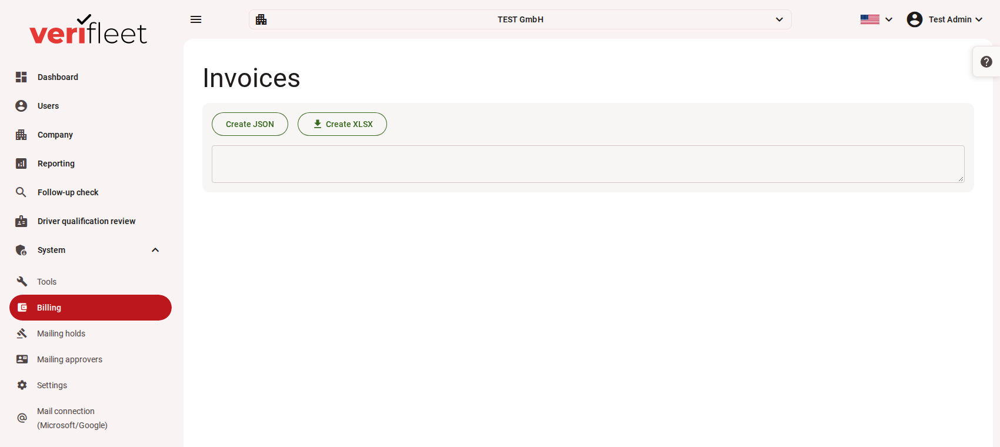

# Billing

The **System › Billing** area generates the monthly invoice data for all companies in the system.
It is based on the services booked per company and the checks performed in the billing
month.

{ border-effect="line" thumbnail="true" width="100%" }

!!! note
    This area is only visible to users with the **Administrator** role.

## Running the invoice generation

1. Click **"Create JSON"** or **"Create XLSX"**. There is no month selection: the run bills the **previous month**
   and includes all active companies that have billing enabled.
2. The system calculates the invoice items for every company from its booked services.
3. With "Create JSON" the generated data appears in the text field below, with "Create XLSX" the download starts.

## Export

- **Excel (XLSX):** each company gets its own worksheet with company header data (name,
  address), billing month and all items (description, quantity, unit, unit price and
  total price).
- **JSON:** complete invoice data in machine-readable form for further processing in your
  accounting system.

## Billing settings per company

How a company is billed is configured on the company itself under
**Edit company › Platform › Billing**:

| Setting | Meaning |
|---|---|
| **Do not bill** | The company does not appear in the invoice run. |
| **Own invoice** | The company gets its own invoice. |
| **Via the parent company** | The costs appear on the invoice of the next higher company that has its own invoice. |
