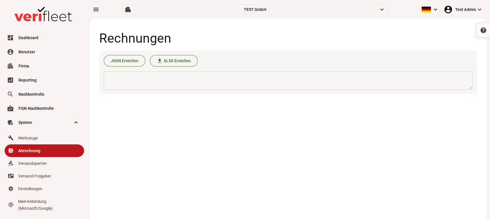

# Abrechnung

Der Bereich **System › Abrechnung** erzeugt die monatlichen Rechnungsdaten für alle Firmen im
System. Grundlage sind die je Firma gebuchten Services und die im Abrechnungsmonat
angefallenen Kontrollen.

{ border-effect="line" thumbnail="true" width="100%" }

!!! note
    Dieser Bereich ist nur für Benutzer mit der Rolle **Administrator** sichtbar.

## Rechnungslauf ausführen

1. Klicken Sie auf **„JSON Erstellen“** oder **„XLSX Erstellen“**. Eine Monatsauswahl gibt es nicht: Der Lauf rechnet den
   **Vormonat** ab und berücksichtigt alle aktiven Firmen, für die eine Abrechnung eingestellt ist.
2. Das System berechnet für jede Firma die Rechnungspositionen aus den gebuchten Services.
3. Bei „JSON Erstellen“ erscheinen die erzeugten Daten im Textfeld darunter, bei „XLSX Erstellen“ startet der Download.

## Export

- **Excel (XLSX):** Jede Firma erhält ein eigenes Arbeitsblatt mit Firmenkopfdaten
  (Name, Anschrift), Abrechnungsmonat und allen Positionen (Beschreibung, Anzahl,
  Einheit, Einzel- und Gesamtpreis).
- **JSON:** Vollständige Rechnungsdaten in maschinenlesbarer Form zur Weiterverarbeitung
  in Ihrer Buchhaltung.

## Abrechnungseinstellungen je Firma

Wie eine Firma abgerechnet wird, legen Sie in der jeweiligen Firma unter
**Firma bearbeiten › Plattform › Abrechnung** fest:

| Einstellung | Bedeutung |
|---|---|
| **Nicht abrechnen** | Die Firma taucht im Rechnungslauf nicht auf. |
| **Eigene Rechnung** | Die Firma bekommt eine eigene Rechnung. |
| **Über die Mutterfirma** | Die Kosten stehen auf der Rechnung der nächsthöheren Firma, die eine eigene Rechnung hat. |
