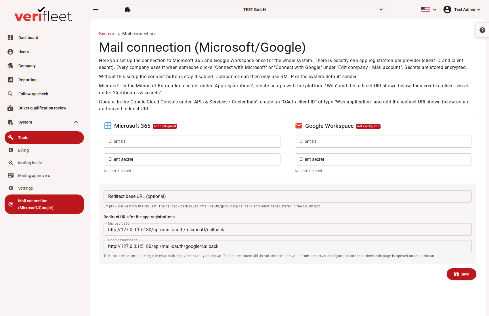

# Mail connection (Microsoft/Google)

Under **System › Mail connection (Microsoft/Google)**, system administrators set up the
connection to Microsoft 365 and Google Workspace once for the whole system. There is exactly one
app registration per provider (client ID and client secret). Every company uses it when someone
clicks "Connect with Microsoft" or "Connect with Google" under **Edit company › Mail account**.

{ border-effect="line" thumbnail="true" width="100%" }

!!! note
    This area is only visible to users with the **system administrator** role. You find it in
    the menu under **System**. A company's own mail account, in contrast, is connected in the
    respective company under **Edit company**.

## What the connection is for

By default, the system sends check requests through the central mail service. Companies can
instead use their **own mailbox** (Microsoft 365 or Google Workspace) as the sender. Drivers then
receive the requests from a familiar sender address of their own organisation, which improves
delivery and acceptance.

Without this setup, the "Connect with Microsoft" and "Connect with Google" buttons stay disabled
in every company. Companies can then only use an SMTP mailbox or the system's default sender.

## Status

Next to each provider you see whether the connection is ready:

| Status | Meaning |
|---|---|
| **configured** | Client ID and client secret are stored on this page. |
| **configured via appsettings** | Nothing is stored on this page; the server brings the values from its configuration. As soon as you save values here, they take precedence. |
| **not configured** | The app registration for this provider is missing. |

Below, the page shows when and by whom the settings were last changed.

## Registering the app with Microsoft

1. Open the **Microsoft Entra admin center** and go to **App registrations**.
2. Create a new app with the platform **"Web"**. As redirect URI, enter the address shown on this
   page under **Redirect URIs for the app registrations** next to "Microsoft 365".
3. Create a client secret under **Certificates & secrets**.
4. Copy the **application (client) ID** and the **client secret** into the "Microsoft 365" card
   and click **Save**.

## Registering the app with Google

1. Open the **Google Cloud Console** and go to **APIs & Services › Credentials**.
2. Create an **OAuth client ID** of type **"Web application"**.
3. As authorized redirect URI, enter the address shown on this page next to "Google Workspace".
4. Copy the **client ID** and **client secret** into the "Google Workspace" card and click
   **Save**.

## Redirect URIs

After signing in with the provider, the browser returns to a fixed address of the system:
`<base URL>/api/mail-oauth/microsoft/callback` or `<base URL>/api/mail-oauth/google/callback`.
The page shows both addresses ready to copy. They must be registered with the provider **exactly
as shown**.

The **redirect base URL** is optional. If it is empty, the system takes the value from the server
configuration, otherwise the address under which you are currently opening the page. Fill it in
if the system can be reached under several addresses.

## Notes

- Client secrets are stored encrypted and never shown again. Leaving a secret field empty when
  saving keeps the stored secret unchanged.
- Changes take effect **immediately, without a restart** of the system.

## Flow for a company

1. The system administrator sets up the connection here once.
2. The company administrator opens **Edit company** and clicks "Connect with Microsoft" or
   "Connect with Google" in the **Mail account** section.
3. After signing in with the provider, the system sends this company's mails through the
   connected mailbox.
