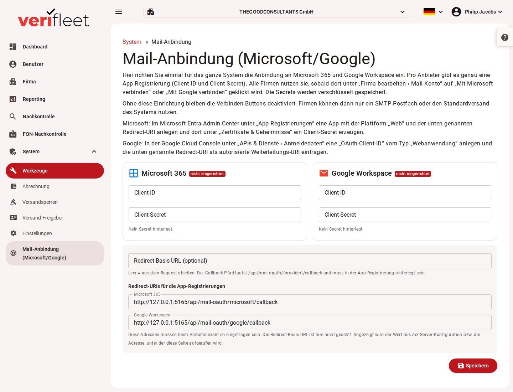

# Mail-Anbindung (Microsoft/Google)

Unter **System › Mail-Anbindung (Microsoft/Google)** richten Systemadministratoren einmal für das
ganze System die Anbindung an Microsoft 365 und Google Workspace ein. Pro Anbieter gibt es genau
eine App-Registrierung (Client-ID und Client-Secret). Alle Firmen nutzen sie, sobald dort unter
**Firma bearbeiten › Mail-Konto** auf „Mit Microsoft verbinden“ oder „Mit Google verbinden“
geklickt wird.

{ border-effect="line" thumbnail="true" width="100%" }

!!! note
    Dieser Bereich ist nur für Benutzer mit der Rolle **Systemadministrator** sichtbar. Sie finden
    ihn im Menü unter **System**. Das Mail-Konto einer Firma selbst wird in der jeweiligen Firma
    unter **Firma bearbeiten** angebunden.

## Wozu die Anbindung dient

Standardmäßig versendet das System Prüfaufforderungen über den zentralen Mail-Dienst. Firmen können
stattdessen ihr **eigenes Postfach** (Microsoft 365 oder Google Workspace) als Absender verwenden.
Die Fahrer erhalten die Aufforderungen dann von einer vertrauten Absenderadresse ihrer eigenen
Organisation. Das verbessert die Zustellung und die Akzeptanz.

Ohne diese Einrichtung bleiben die Knöpfe „Mit Microsoft verbinden“ und „Mit Google verbinden“ in
allen Firmen deaktiviert. Firmen können dann nur ein SMTP-Postfach oder den Standardversand des
Systems nutzen.

## Status

Neben jedem Anbieter steht, ob die Anbindung bereit ist:

| Status | Bedeutung |
|---|---|
| **eingerichtet** | Client-ID und Client-Secret sind auf dieser Seite gespeichert. |
| **eingerichtet über appsettings** | Auf dieser Seite ist nichts gespeichert, der Server bringt die Werte aus seiner Konfiguration mit. Sobald Sie hier Werte speichern, gelten diese. |
| **nicht eingerichtet** | Für diesen Anbieter fehlt die App-Registrierung. |

Darunter steht, wann und von wem die Einstellungen zuletzt geändert wurden.

## App bei Microsoft anlegen

1. Öffnen Sie das **Microsoft Entra Admin Center** und dort **App-Registrierungen**.
2. Legen Sie eine neue App mit der Plattform **„Web“** an. Tragen Sie als Redirect-URI die Adresse
   ein, die auf dieser Seite unter **Redirect-URIs für die App-Registrierungen** bei „Microsoft 365“
   steht.
3. Erzeugen Sie unter **Zertifikate & Geheimnisse** ein Client-Secret.
4. Übertragen Sie die **Anwendungs-ID (Client-ID)** und das **Client-Secret** in die Karte
   „Microsoft 365“ und klicken Sie auf **Speichern**.

## App bei Google anlegen

1. Öffnen Sie die **Google Cloud Console** und dort **APIs & Dienste › Anmeldedaten**.
2. Legen Sie eine **OAuth-Client-ID** vom Typ **„Webanwendung“** an.
3. Tragen Sie als autorisierte Weiterleitungs-URI die Adresse ein, die auf dieser Seite bei
   „Google Workspace“ steht.
4. Übertragen Sie **Client-ID** und **Clientschlüssel** in die Karte „Google Workspace“ und klicken
   Sie auf **Speichern**.

## Redirect-URIs

Nach der Anmeldung beim Anbieter kehrt der Browser an eine feste Adresse des Systems zurück:
`<Basis-URL>/api/mail-oauth/microsoft/callback` bzw. `<Basis-URL>/api/mail-oauth/google/callback`.
Die Seite zeigt beide Adressen fertig zum Kopieren an. Sie müssen beim Anbieter **exakt so**
eingetragen sein.

Die **Redirect-Basis-URL** ist optional. Ist sie leer, nimmt das System den Wert aus der
Server-Konfiguration, sonst die Adresse, unter der Sie die Seite gerade aufrufen. Tragen Sie sie
ein, wenn das System unter mehreren Adressen erreichbar ist.

## Hinweise

- Die Client-Secrets werden verschlüsselt gespeichert und nie wieder angezeigt. Ein leeres
  Secret-Feld beim Speichern lässt das gespeicherte Secret unverändert.
- Änderungen greifen **sofort, ohne Neustart** des Systems.

## Ablauf für eine Firma

1. Der Systemadministrator richtet hier einmalig die Anbindung ein.
2. Der Firmen-Administrator öffnet **Firma bearbeiten** und klickt im Bereich **Mail-Konto** auf
   „Mit Microsoft verbinden“ bzw. „Mit Google verbinden“.
3. Nach der Anmeldung beim Anbieter versendet das System die Mails dieser Firma über das
   verbundene Postfach.
