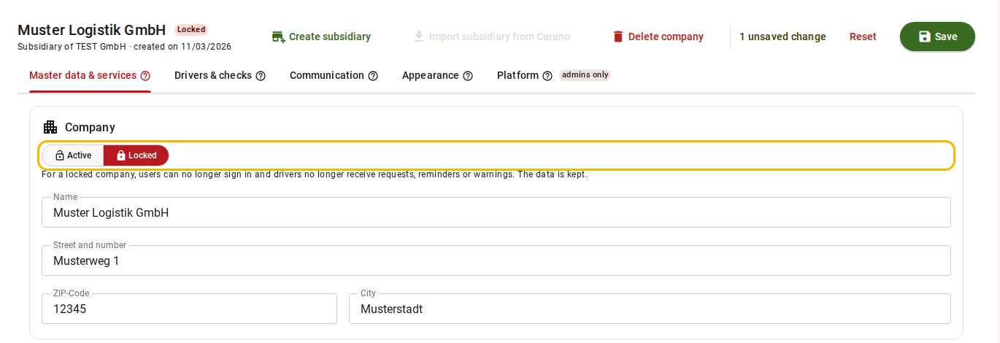
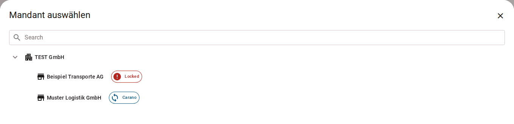

# Blocking / activating a company

You can block or activate a company. For a blocked company, users can no longer sign in and drivers no longer receive
requests, reminders or warnings. The data is kept.

1. Select the company (field at the top of the header bar) and open the "Master data & services" tab under "Company" in the menu.
2. In the "Company" section, set the switch at the very top to "Locked" or "Active".
3. Then click "Save" at the top right of the page header to persist the change.

{ border-effect="line" thumbnail="true" width="500" }

!!! note
    Your **own** company cannot be locked; the switch is greyed out there. A locked company is also marked with a
    "Locked" tag next to the company name in the page header.

## Locked companies in the company selection

Locked companies are marked with a "Locked" tag in the "Mandant auswählen" dialog (field at the top of the header bar;
the dialog title is currently shown in German in every interface language).

{ border-effect="line" thumbnail="true" width="500" }
