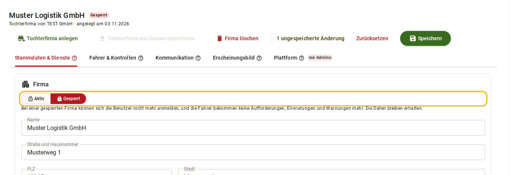
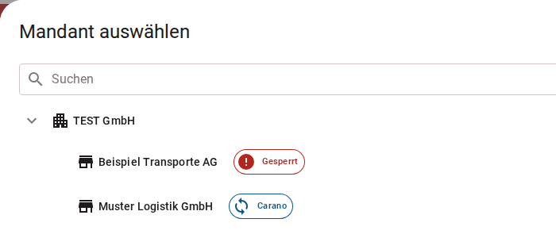

# Firma sperren / aktivieren

Sie können eine Firma sperren beziehungsweise aktivieren. Bei einer gesperrten Firma können sich die Benutzer nicht mehr
anmelden, und die Fahrer bekommen keine Aufforderungen, Erinnerungen und Warnungen mehr. Die Daten bleiben erhalten.

1. Wählen Sie die Firma aus (Feld oben in der Kopfleiste) und öffnen Sie im Menü "Firma" den Reiter "Stammdaten & Dienste".
2. Stellen Sie im Abschnitt "Firma" den Umschalter ganz oben auf "Gesperrt" beziehungsweise "Aktiv".
3. Klicken Sie danach in der Kopfzeile oben rechts auf "Speichern", um die Änderung zu sichern.

{ border-effect="line" thumbnail="true" width="500" }

!!! note
    Die **eigene** Firma lässt sich nicht sperren; der Umschalter ist dort ausgegraut. Eine gesperrte Firma erkennen Sie
    außerdem am Kennzeichen „Gesperrt“ neben dem Firmennamen in der Kopfzeile.

## Gesperrte Firmen in der Firmen-Auswahl

Gesperrte Firmen sind im Dialog „Mandant auswählen“ (Feld oben in der Kopfleiste) durch das Kennzeichen „Gesperrt“
gekennzeichnet.

{ border-effect="line" thumbnail="true" width="500" }
