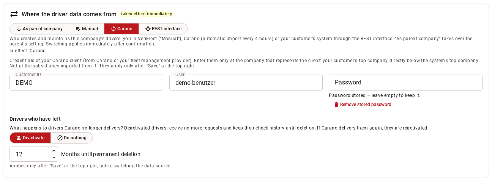
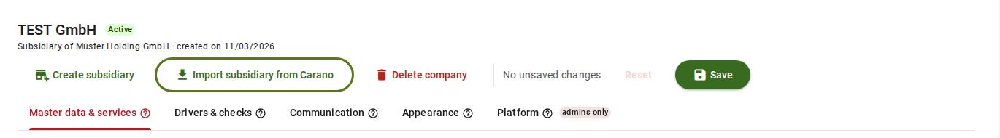
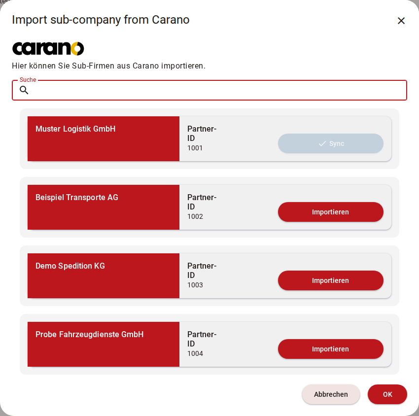
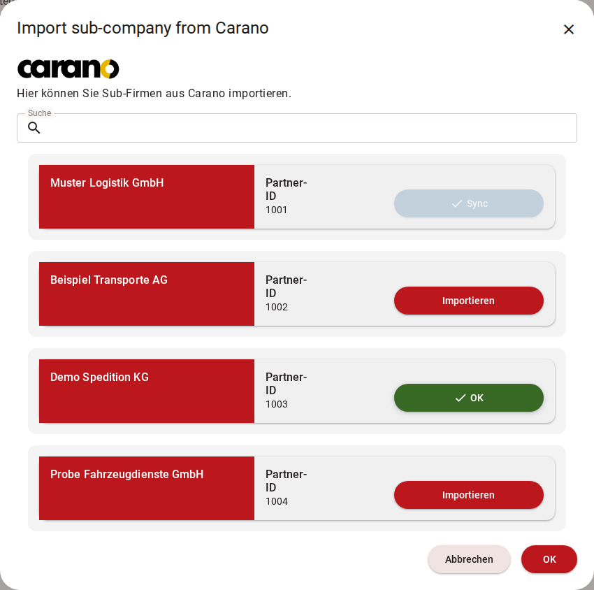
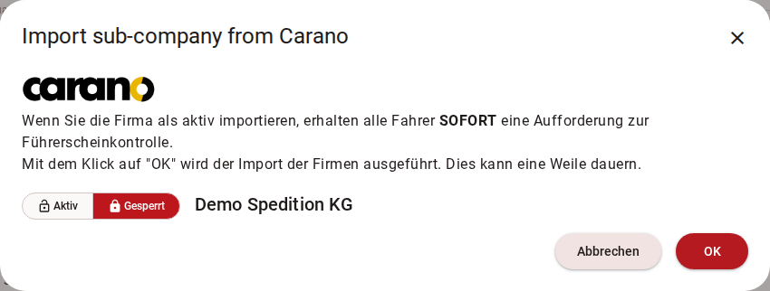
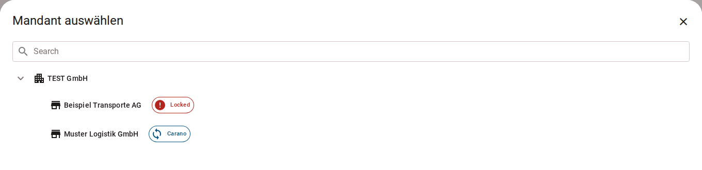

# Carano connection

Companies do not have to be created manually — they can alternatively be imported from the
Carano fleet-management system. For this, Carano has to provide them via the dedicated
REST API.

With the Carano link, your data (companies and users/drivers) is updated every 4 hours. You can import individual companies or all of them — you decide when calling the
import function described below.

!!! info "Prerequisite: data source “Carano”"
    The Carano connection is part of the **"Where the driver data comes from"** section in the **"Platform"** tab (formerly
    "Carano connection"). Credentials and import are only available when the **driver data
    source** there is set to **"Carano"**. How to choose the data source or detach a company from
    Carano again — without losing the Carano IDs — is described under
    [Driver data & interface](company-driver-data.md).

!!! note
    Talk to your Carano support or your fleet-management provider (if they manage your
    companies via Carano) to obtain the required credentials. You need:

    1. your tenant identifier
    2. your username
    3. your password

!!! warning
    IMPORTANT:

    In the Carano system, companies are ALWAYS attached below a tenant. You therefore have
    to
    1. create the tenant in the system
    2. enter your credentials in the tenant  **(Credentials may only be entered at
    tenant level. Do not enter them in a company already imported from Carano — one level
    below!)**
    3. import the desired companies below the tenant

    The tenant is your customer's top company, i.e. the company directly below the system's top company. The system's top
    company itself has no parent company and therefore no "Platform" tab; no credentials can be entered there.

## Entering the Carano tenant credentials

### Creating / selecting the Carano tenant

After [creating a company](company-create.md) that you want to use as the Carano tenant
(usually your customer's top company, directly below the system's top company), select it via the search function.

### Entering the credentials

1. Click "Company" in the menu.
2. Open the "Platform" tab and there the "Where the driver data comes from" section (formerly "Carano connection").
3. Set the driver data source to "Carano" and confirm the change
   (see [Driver data & interface](company-driver-data.md#changing-the-data-source)).
4. Enter tenant identifier, user and password in the dedicated fields. They appear as soon as the effective data source is "Carano".
5. Save with the "Save" button at the top right. Unlike switching the data source, the credentials only apply after saving.

{ border-effect="line" thumbnail="true" width="500" }

!!! note
    The stored Carano password is never displayed; the field stays empty. Leave it empty to
    keep the stored password; a newly entered password replaces it. "Remove stored password"
    deletes it.

!!! note
    The Carano fields are only visible with the required user permission ("Carano import
    authorized"). Contact your administrator if you cannot see the "Where the driver data comes from"
    section.

## Drivers who have left

If Carano stops delivering a driver, the import no longer deletes them right away. In the "Platform" tab, "Where the driver
data comes from" section, at the tenant (below the credentials) you choose what happens instead. The "Departed drivers"
block appears only when the effective data source is "Carano" and the company was not itself imported from Carano.
The setting applies only after "Save" at the top right:

- **Deactivate** (default): The driver is deactivated and receives no more requests. Their check history is kept. After
  the retention period (default 12 months, adjustable from 1 to 60 months) they are permanently deleted together with
  their check history.
- **Do nothing**: Drivers who have left stay active unchanged. The import then deletes nothing either; drivers the import already deactivated stay deactivated and are no longer deleted.

If Carano delivers a driver the import deactivated again, they are reactivated automatically. The import never touches
manually deactivated drivers.

!!! note
    After an incomplete or conspicuously small delivery from Carano the import neither deactivates nor deletes and writes
    a warning to the log. The setting applies to all companies below the tenant and can only be changed with the
    "Carano import allowed" permission.

## Importing companies

After entering the credentials in the Carano tenant company, the button
"Import subsidiary from Carano" is available in the page header, below the company name — only as long as the driver
data source is set to "Carano". It is greyed out while tenant identifier, user and password are missing or the
company itself already has a Carano customer number (imported companies).

{ border-effect="line" thumbnail="true" width="500" }

### Opening the Carano import

Click the button to open the "Import sub-company from Carano" dialog.

!!! note
    The texts inside this dialog (for example "Importieren" and "Abbrechen") and the title of the company selection
    dialog ("Mandant auswählen") are currently shown in German in every interface language, as the screenshots show.

{ border-effect="line" thumbnail="true" width="500" }

You can search for companies by typing into the search bar — useful when the list is long.

Proceed as follows:

#### 1. Select companies

Click the "Import" button behind each company to synchronise; its label changes to "OK".
Click again to undo. Finally click "OK" at the bottom right to confirm your selection.

{ border-effect="line" thumbnail="true" width="500" }

!!! note
    Companies already synchronised are marked with "Sync" on the button behind the
    company name.

#### 2. Blocked import

In the following dialog, choose whether to import the company as active or blocked.

!!! warning
    If you import a company as active, all users/drivers may immediately receive a
    driving-licence check request. It is strongly recommended to always import companies
    as "blocked" first and set them to "active" after verifying the imported data.

{ border-effect="line" thumbnail="true" width="500" }

#### 3. Import successful?

A successful import is confirmed by a system message. If the import fails, verify your
credentials or contact support. Confirm the dialog with "OK".

### Import marker in the search list

After importing a company for synchronisation, it carries a "Carano" marker in the company selection (the field
at the top of the header bar, dialog "Mandant auswählen") for as long as its data source is Carano —
so you can identify Carano-synchronised companies right at selection time.

{ border-effect="line" thumbnail="true" width="500" }
