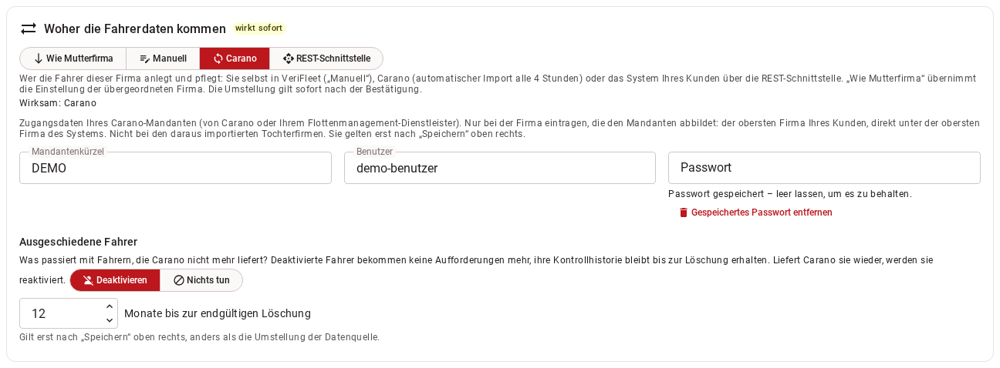
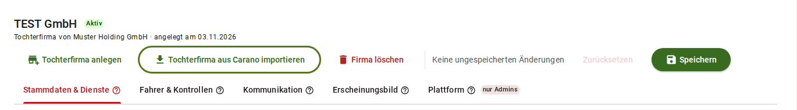
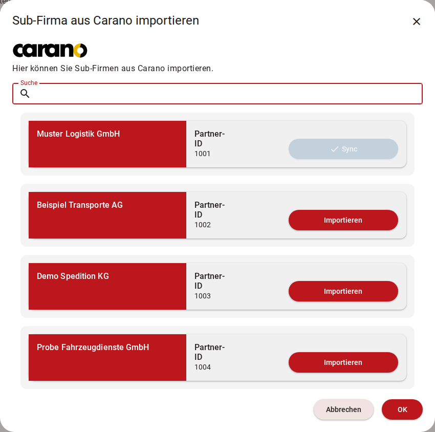
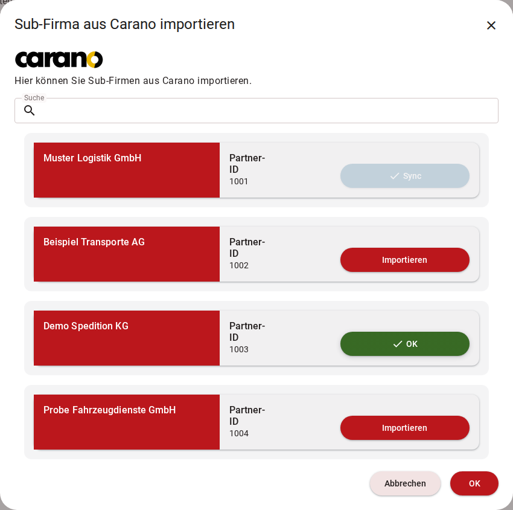
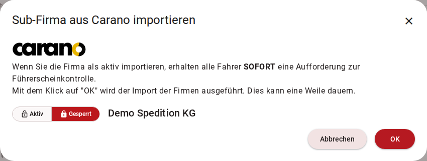
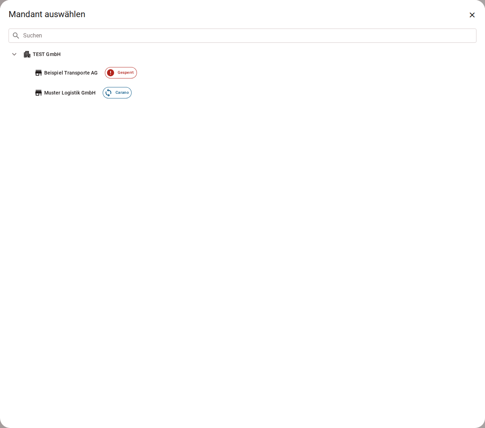

# Carano Anbindung

<show-structure for="chapter,procedure" depth="3"/>

Firmen können nicht nur manuell angelegt werden. Sie können alternativ aus dem Fuhrpark-Management-System Carano
importiert werden. Um Firmen aus Carano importieren zu können, müssen diese seitens Carano auf der dafür vorgesehenen
Rest-API zur Verfügung gestellt werden.

Mit Hilfe der Carano-Verknüpfung werden Ihre Daten (Firmen und Benutzer/Fahrer) alle 4 Stunden aktualisiert.
Sie können dabei entweder einzelne Firmen importieren oder alle Ihre Firmen importieren. Dies entscheiden Sie beim
Aufruf der Importfunktion, die weiter unten beschrieben wird.

!!! info "Voraussetzung: Datenquelle „Carano“"
    Die Carano-Anbindung ist Teil des Abschnitts **„Woher die Fahrerdaten kommen“** im Reiter **„Plattform“** (früher
    „Carano-Anbindung“). Zugangsdaten und Import stehen nur zur Verfügung, wenn dort als
    **Datenquelle der Fahrer „Carano“** eingestellt ist. Wie Sie die Datenquelle wählen oder eine
    Firma wieder von Carano lösen — ohne Carano-Kennungen zu verlieren —, lesen Sie unter
    [Fahrerdaten & Schnittstelle](company-driver-data.md).

!!! note
    Sprechen Sie mit Ihrem Carano-Support oder mit Ihrem Flotten-Management-Dienstleister (wenn dieser Ihre Firma/Firmen)
    über Carano managed, um die notwendigen Zugangsdaten zu erhalten. Sie benötigen:

    1. Ihr Mandanten-Kürzel
    2. Ihren Benutzernamen
    3. Ihr Passwort

!!! warning
    WICHTIGER HINWEIS:

    Bitte beachten Sie, das im Carano-System Firmen IMMER unterhalb eines Mandanten aufgehängt sind. Aus diesem Grund
    müssen Sie
    1. den Mandanten im System anlegen
    2. Im Mandaten Ihre Zugangsdaten eintragen  **(Die Zugangsdaten dürfen nur auf Ebene des Mandanten eingetragen
    werden. Tragen Sie die Zugangsdaten nicht in einer bereits aus Carano importierten Firma - also eine Ebene tiefer - ein!)**
    3. Unterhalb des Mandanten die gewünschten Firmen importieren

    Der Mandant ist die oberste Firma Ihres Kunden, also die Firma direkt unter der obersten Firma des Systems. Die oberste
    Firma des Systems selbst hat keine Mutterfirma und damit keinen Reiter „Plattform“; dort lassen sich keine
    Zugangsdaten eintragen.

## Zugangsdaten des Carano-Mandanten eintragen

### Carano-Mandanten anlegen / auswählen

Nachdem Sie - wie oben beschrieben - eine [Firma angelegt](company-create.md) haben, die Sie als Carano-Mandant verwenden wollen (in der Regel die oberste Firma Ihres Kunden,
direkt unter der obersten Firma des Systems), wählen Sie diese Firma über die Suchfunktion
aus.

### Zugangsdaten eintragen

1. Klicken Sie im Menü auf "Firma".
2. Öffnen Sie den Reiter "Plattform" und dort den Abschnitt "Woher die Fahrerdaten kommen" (früher "Carano-Anbindung").
3. Stellen Sie die Datenquelle der Fahrer auf "Carano" und bestätigen Sie die Umstellung
   (siehe [Fahrerdaten & Schnittstelle](company-driver-data.md#datenquelle-umstellen)).
4. Tragen Sie Mandantenkürzel, Benutzer und Passwort in die dafür vorgesehenen Felder ein. Die Felder erscheinen, sobald
   die wirksame Datenquelle "Carano" ist.
5. Speichern Sie die Änderungen durch Klick auf den Button "Speichern" oben rechts. Anders als die Umstellung der
   Datenquelle gelten die Zugangsdaten erst nach dem Speichern.

{ border-effect="line" thumbnail="true" width="500" }

!!! note
    Das gespeicherte Carano-Passwort wird nie angezeigt, das Feld bleibt leer. Lassen Sie es leer,
    bleibt das gespeicherte Passwort erhalten; ein neu eingegebenes Passwort ersetzt es. Mit
    "Gespeichertes Passwort entfernen" löschen Sie es.

!!! note
    Sie sehen die Eingabefelder für die Carano-Anbindung nur, wenn Sie die notwendigen Benutzer-Berechtigungen
    besitzen ("Carano-Import berechtigt"). Wenden Sie sich ggf. an Ihren Administrator, falls Sie den Bereich
    "Woher die Fahrerdaten kommen" nicht sehen.

## Ausgeschiedene Fahrer

Liefert Carano einen Fahrer nicht mehr, löscht der Import ihn nicht sofort. Im Reiter "Plattform", Abschnitt "Woher die
Fahrerdaten kommen", beim Mandanten (unter den Zugangsdaten) legen Sie fest, was stattdessen passiert. Der Block
"Ausgeschiedene Fahrer" erscheint nur, wenn die wirksame Datenquelle "Carano" ist und die Firma nicht selbst aus Carano
importiert wurde. Die Einstellung gilt erst nach "Speichern" oben rechts:

- **Deaktivieren** (Standard): Der Fahrer wird deaktiviert und bekommt keine Aufforderungen mehr. Seine
  Kontrollhistorie bleibt erhalten. Nach der eingestellten Aufbewahrungsfrist (Standard 12 Monate, einstellbar von 1 bis
  60 Monaten) wird er mit seiner Kontrollhistorie endgültig gelöscht.
- **Nichts tun**: Ausgeschiedene Fahrer bleiben unverändert aktiv. Dann löscht der Import auch nichts; bereits vom Import deaktivierte Fahrer bleiben deaktiviert und werden nicht mehr gelöscht.

Liefert Carano einen vom Import deaktivierten Fahrer wieder, wird er automatisch reaktiviert. Manuell deaktivierte Fahrer
fasst der Import nie an.

!!! note
    Nach einer unvollständigen oder auffällig kleinen Lieferung von Carano deaktiviert und löscht der Import nichts und
    schreibt eine Warnung ins Protokoll. Die Einstellung gilt für alle Firmen unterhalb des Mandanten und ist nur
    mit dem Recht "Carano-Import berechtigt" änderbar.

## Firmen importieren

Nachdem Sie Ihre Zugangsdaten in die Carano-Mandanten-Firma eingetragen haben, steht Ihnen in der
Kopfzeile der Seite, unter dem Firmennamen, die Schaltfläche "Tochterfirma aus Carano importieren" zur Verfügung — nur solange die
Datenquelle der Fahrer auf "Carano" steht. Sie ist ausgegraut, solange Mandantenkürzel, Benutzer und Passwort fehlen
oder die Firma selbst schon eine Carano-Kundennummer hat (importierte Firmen).

{ border-effect="line" thumbnail="true" width="500" }

### Carano-Import aufrufen

Klicken Sie auf die Schaltfläche, um den Dialog "Sub-Firma aus Carano importieren" zu öffnen.

{ border-effect="line" thumbnail="true" width="500" }

Sie können im Carano-Import Dialog durch Eingabe eines Suchbegriffs in der Suchzeile nach Firmen suchen. Dies
ermöglicht ein einfacheres Auffinden der zu synchronisierenden Firmen, wenn viele Firmen in der Liste aufgeführt sind.

Gehen Sie nun wie folgt vor:

#### 1. Firmen auswählen
Klicken Sie bei den zu synchronisierenden Firmen auf den Button "Importieren" hinter dem Firmennamen. Die Aufschrift
des Buttons ändert sich in "OK". Sie können Ihre Auswahl durch nochmaliges Klicken rückgängig machen. Klicken Sie
abschließend rechts unten auf "OK", um Ihre Auswahl zu bestätigen.

{ border-effect="line" thumbnail="true" width="500" }

!!! note
    Firmen die bereits synchronisiert werden, sind durch die Aufschrift "Sync" auf dem Button hinter dem
    Firmennamen gekennzeichnet.

#### 2. gesperrter Import

Wählen Sie im folgenden Dialog, ob Sie die Firma aktiv oder gesperrt importieren wollen.

!!! warning
    Wenn Sie eine Firma aktiv importieren erhalten alle Benutzer / Fahrer ggfls. sofort eine Aufforderung zur Prüfung des
    Führerscheins. Es wird ausdrücklich empfohlen Firmen immer zunächst "gesperrt" zu importieren und nach Prüfung
    der Import-Daten auf "aktiv" zu setzen.

{ border-effect="line" thumbnail="true" width="500" }

#### 4. Import erfolgreich?

Ein erfolgreicher Import wird durch eine entsprechnde Meldung des Systems bestätigt. Sollte der import nicht
erfolgreich sein, prüfen Sie Ihre Zugriffsdaten oder wenden Sie sich an Ihren Support. Bestätigen Sie den Dialog
mit "OK".

### Import-Kennzeichen in der Suchliste

Nachdem Sie eine Firma zur Synchronisation mit Carano importiert haben, hat die Firma in der Firmen-Auswahl (Feld oben in der Kopfleiste, Dialog „Mandant auswählen“) ein
entsprechendes Kennzeichen „Carano“, solange ihre Datenquelle Carano ist. So erkennen Sie Firmen, die mit Carano synchronisisert werden bereits bei der
Firmen-Auswahl bzw. bei der Firmen-Suche.

{ border-effect="line" thumbnail="true" width="500" }