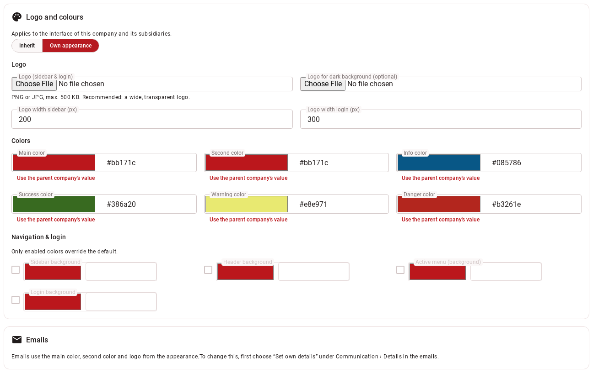

# Tab "Appearance"

Logo and colours of the interface and the emails.

!!! note "Who sees this tab?"
    Users with the `AlterCorporateIdentity` permission (administrator or custom role), subsidiaries only.

{ border-effect="line" thumbnail="true" width="500" }

## Logo and colours

Applies to the interface of this company and its subsidiaries. Choose **"Inherit"** (from the parent company) or
**"Own appearance"**.

| Setting | What it does |
|---|---|
| **Logo (sidebar & login)** | PNG or JPG, at most 500 KB; a wide, transparent logo is recommended. **"Remove logo"** takes it out again. The logo is also used in mails. |
| **Logo for dark background (optional)** | For dark areas. |
| **Logo width sidebar (px)**, **Logo width login (px)** | Width in pixels, 20 to 1000. |
| **Main colour**, **Second colour**, info, success, warning and error colour | Colours of the interface; main and second colour also apply to the mails. |
| Sidebar, header, active menu and login background (group "Navigation & Login") | Optional; only enabled colours override the default. |

**Every colour** has a hex field (`#RRGGBB`, e.g. `#bb171c`), a colour picker and, when there is a value to take over, the
button **"Use the parent company's value"** (if no parent company has its own colours, it is the default). An invalid format
is shown immediately and prevents saving.

!!! warning "Contrast warning"
    If the contrast is below **4.5 : 1**, a notice appears: for the main colour for **white text on the colour**, for the
    second colour for **the colour as a link on white**. The colour can still be saved; the system does not suggest
    colours.

## Emails

Mails use the main colour, second colour and logo from the appearance. If they need something different, tick
**"Different for emails only"** and enter **Main color of emails**, **Second color of emails** and optionally a **Logo for
emails only** (PNG or JPEG). Without a mail logo, the appearance logo applies.

Prerequisite: under [Communication › Details in the emails](company-edit-communication.md) **"Set own details"** is chosen;
otherwise a corresponding notice appears there. With "Inherit", the parent company's values apply.
