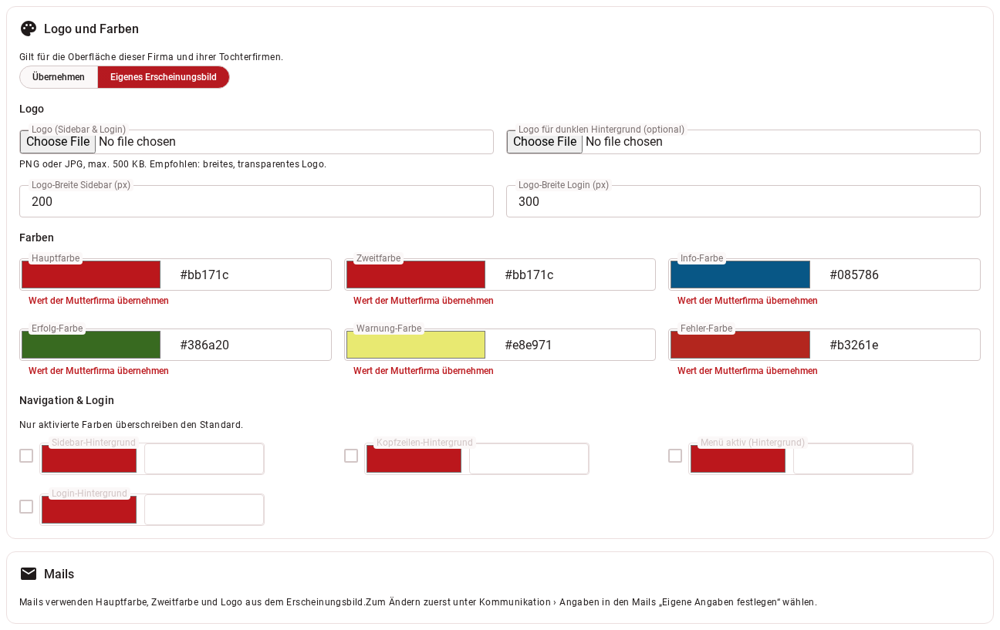

# Reiter „Erscheinungsbild“

Logo und Farben der Oberfläche und der Mails.

!!! note "Wer sieht diesen Reiter?"
    Benutzer mit dem Recht `AlterCorporateIdentity` (Administrator oder benutzerdefinierte Rolle), nur bei Tochterfirmen.

{ border-effect="line" thumbnail="true" width="500" }

## Logo und Farben

Gilt für die Oberfläche dieser Firma und ihrer Tochterfirmen. Wählen Sie **„Übernehmen“** (von der Mutterfirma) oder
**„Eigenes Erscheinungsbild“**.

| Einstellung | Was sie bewirkt |
|---|---|
| **Logo (Sidebar & Login)** | PNG oder JPG, höchstens 500 KB; breites, transparentes Logo empfohlen. Mit **„Logo entfernen“** nehmen Sie es wieder heraus. Das Logo wird auch in Mails verwendet. |
| **Logo für dunklen Hintergrund (optional)** | Für dunkle Flächen. |
| **Logo-Breite Sidebar (px)**, **Logo-Breite Login (px)** | Breite in Pixel, 20 bis 1000. |
| **Hauptfarbe**, **Zweitfarbe**, Info-, Erfolg-, Warnung-, Fehler-Farbe | Farben der Oberfläche; Hauptfarbe und Zweitfarbe gelten auch für die Mails. |
| Sidebar-, Kopfzeilen-, Menü-aktiv- und Login-Hintergrund (Gruppe „Navigation & Login“) | Optional; nur aktivierte Farben überschreiben den Standard. |

**Jede Farbe** hat ein Hex-Feld (`#RRGGBB`, z. B. `#bb171c`), einen Farbwähler und, wenn es einen Wert zum Übernehmen
gibt, die Schaltfläche **„Wert der Mutterfirma übernehmen“** (gibt es keine Mutterfirma mit eigenen Farben, ist es der
Standard). Ein ungültiges Format wird sofort angezeigt und verhindert das Speichern.

!!! warning "Kontrastwarnung"
    Liegt der Kontrast unter **4,5 : 1**, erscheint ein Hinweis: bei der Hauptfarbe für **weiße Schrift
    auf der Farbe**, bei der Zweitfarbe für **die Farbe als Link auf Weiß**. Die Farbe lässt sich trotzdem
    speichern; vorgegebene Farben schlägt das System nicht vor.

## Mails

Mails verwenden Hauptfarbe, Zweitfarbe und Logo aus dem Erscheinungsbild. Brauchen sie etwas anderes, setzen
Sie den Haken **„Abweichend nur für Mails“** und tragen **Hauptfarbe der Mails**, **Zweitfarbe der Mails**
und optional ein **Logo nur für Mails** (PNG oder JPEG) ein. Ohne Mail-Logo gilt das Logo des Erscheinungsbilds.

Voraussetzung: Unter [Kommunikation › Angaben in den Mails](company-edit-communication.md) ist
**„Eigene Angaben festlegen“** gewählt; sonst steht dort ein entsprechender Hinweis. Bei „Übernehmen“ gelten die Werte
der Mutterfirma.
