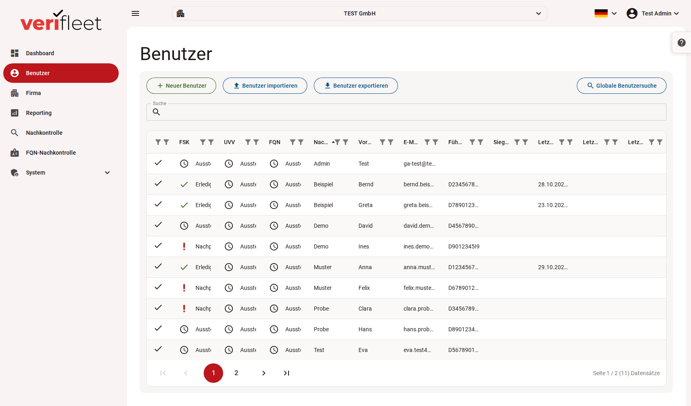

# Benutzerverwaltung

Im Bereich **Benutzer** verwalten Sie alle Fahrer bzw. Nutzer Ihres Fuhrparks. Hier können neue Benutzer angelegt, bestehende Daten eingesehen, kontrolliert und exportiert werden.

{ border-effect="line" thumbnail="true" width="100%" }

## Übersicht der Benutzerliste

Die Tabelle zeigt alle registrierten Benutzer samt relevanter Informationen:

| Spalte | Beschreibung |
|--------|--------------|
| **FSK**, **UVV**, **FQN** | Status der Führerscheinkontrolle, der UVV-Unterweisung und der FQN-Kontrolle (✓ Erledigt / ⏱ Ausstehend / ❗ Nachprüfung); die Spalten gibt es, wenn der Dienst gebucht ist |
| **Nachname / Vorname** | Name des Benutzers |
| **E-Mail** | Kontaktadresse |
| **Führerscheinnummer** | Nummer des hinterlegten Führerscheins |
| **Siegel-Nr.** | Siegelnummer des zuletzt geprüften Führerscheins |
| **Letzte FSK-Kontrolle**, **Letzte UVV-Unterweisung**, **Letzte FQN-Kontrolle** | Datum der letzten erfolgreich durchgeführten Kontrolle bzw. Unterweisung |

## Funktionen im Überblick

### Benutzer hinzufügen

Mit einem Klick auf **„+ Neuer Benutzer“** können Sie einen neuen Fahrer bzw. Benutzer anlegen. Dabei werden Name, Kontaktdaten und ggf. Führerscheininformationen eingegeben.

### Benutzer importieren

Nutzen Sie den Button **„Benutzer importieren“**, um eine Liste von Benutzern über eine Datei (z. B. CSV oder Excel) gesammelt hochzuladen.

### Benutzer exportieren

Über **„Benutzer exportieren“** lassen sich alle bestehenden Benutzerdaten zur weiteren Verarbeitung herunterladen.

### Globale Benutzersuche

Mit der **globalen Suche** oben rechts können Sie benutzerübergreifend nach Namen, E-Mail-Adressen oder Führerscheinnummern suchen.

## Filter- und Sortierfunktionen

- Die Tabelle kann über die Spaltenüberschriften sortiert werden (z. B. nach Nachname).
- Der Status der Führerscheinkontrolle wird visuell durch Symbole und farbliche Markierungen angezeigt.

## Seitenwechsel

Am unteren Rand der Tabelle befindet sich eine Paginierung, mit der Sie durch mehrere Seiten blättern können. Es wird die aktuelle Seite und die Gesamtanzahl der Benutzer angezeigt.

## Hinweise

- **Ausstehende Kontrollen** sollten regelmäßig überprüft und nachgeholt werden.
- Die Führerscheinkontrolle kann aus der Detailansicht eines Benutzers initiiert oder dokumentiert werden (nicht im Screenshot sichtbar).
- Die Benutzerverwaltung ist eng mit der Funktion „Nachkontrolle“ verbunden, welche spezifische Kontrollzyklen umsetzt.